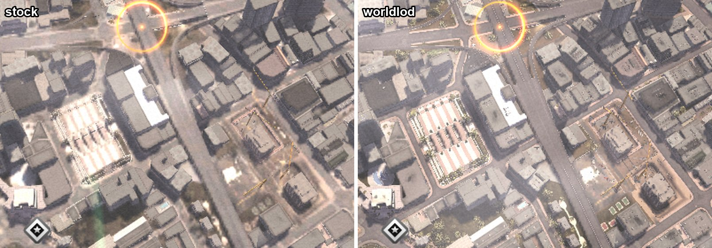

# DSF Enhanced

Improvements for Driver: San Francisco on PC (exe version 1.04), in two parts.
Each release has a ZIP for each:

- **DSF Enhanced** (`DSF-Enhanced-<version>.zip`): an ASI plugin that fixes ultrawide
  and cinematics, adds borderless mode and better filtering, raises detail and
  traffic, and lifts engine limits.
- **worldlod** (`worldlod-<version>.zip`): a high-detail map for the upper Shift levels,
  built from your own copy of the game. It brings DSF Enhanced along.

## DSF Enhanced

- Fixes the aspect ratio and widens gameplay FOV on ultrawide screens.
- Fits Bink cinematics inside the area the game draws them in, so movies keep their proportions.
- Adds borderless windowed mode and an option to turn off VSync.
- Forces anisotropic and trilinear texture filtering. It also has mip and LOD-bias settings.
- Draws traffic cars at full detail out to their draw distance, raises other gameplay LOD thresholds, and lets you extend how far away civilian traffic spawns.
- Shrinks the distant brake and position lamp flares to small dots.
- In the garage's vehicles screen, Up/Down switch to the previous or next maker while a maker's cars are open, so every maker's cars can be browsed without going back to the maker list.
- Skips the legal-screen wait and dismisses the prompt about Ubisoft's servers, which no longer exist.
- Lifts three engine limits that bigger world or car archives run into and crash on: 45,000 resources loaded at once (`[Limits] ResourceArenaExtraNodes`, 135,000 more by default, about 3 MB), 16,384 resource references waiting to be resolved (`[Limits] PendingResourceReferences`, 131,072 by default, 1.5 MB), and 15,000 submodels loaded at once (`[Limits] SubmodelTableExtraNodes`, 60,000 more by default, about 1.4 MB).

### Install

Copy three files from `DSF-Enhanced-<version>.zip` into the game folder, next to `Driver.exe`:

- `winmm.dll` (Ultimate ASI Loader)
- `dsf_enhanced.asi`
- `dsf_enhanced.ini`

Settings live in `dsf_enhanced.ini`. The defaults turn on borderless mode, 16x anisotropic filtering, trilinear filtering, and higher gameplay detail. A few values you may want to change:

- `TrafficSpawnRadius=500` sets how far from you civilian cars spawn and despawn, in metres. `350` is the game's radius; `500` is the maximum, because larger radii overflow the game's traffic pools and crash.
- `VehicleFullDetail=0` restores the game's vehicle LOD steps; `VehicleLODThresholdScale` then scales them.
- `LODEngineThresholdScale` (terrain, pedestrians, drivers) and `MapDetailLODThresholdScale` at `1.0` restore the native LOD thresholds.
- Clear `DRLFlareScale` and `DRLFlareBrightness` in `[Lights]` to keep the game's lamp flares.
- `[General] Log=0` stops the plugin from writing `dsf_enhanced.log`.

To uninstall, delete the three files. If the game already has a `winmm.dll`, from another ASI loader for example, back it up before installing. Nothing here touches `Driver.exe` or `gameconfig.txt`.

## worldlod: a high-detail upper Shift

When you Shift up, the game draws one low-detail model of the whole city: flat ground under plain building shells. worldlod rebuilds it from the game's own detailed areas, with real roads, kerbs, paving, trees and bushes, building detail and painted road text. It reads your `san_francisco.dngc` and writes the new map into it, with a backup. No game data is shipped.



### Install

1. Download `worldlod-<version>.zip` from the [latest release](https://github.com/xob0t/dsf-enhanced/releases/latest) and unzip it anywhere.
2. Close the game and double-click `install.cmd`.

The first time, it asks for the game folder and installs [uv](https://docs.astral.sh/uv/), which brings the Python worldlod runs on. It puts DSF Enhanced into the game if it isn't there, because the bigger map needs its `[Limits]` fixes. Then it builds the map (a minute or two) and installs it. `install.cmd --uninstall` puts the original map back and removes the DSF Enhanced files it added; the backup of the original map stays in the game's `worldlod-backup` folder. Options (`--no-trees`, `--no-buildings`, `--no-road-text`) and how it works are in [worldlod/README.md](worldlod/README.md).

## Build

You need Windows, PowerShell, and the Visual Studio 2022 C++ build tools with the x86 toolchain and a Windows SDK.

From the repository root:

```powershell
.\build.ps1
```

This writes the plugin files, this README, the license, `DSF-Enhanced.zip` and `worldlod.zip` to `dist/`. To install the plugin into a local copy of the game:

```powershell
.\install.ps1 -GamePath "D:\Games\Driver San Francisco"
```

`install.ps1` runs the build first if `dist/` is missing any files. worldlod's own development setup (uv, tests, ruff) is in [worldlod/README.md](worldlod/README.md).

## Releases

Releases are built by GitHub Actions ([.github/workflows/build.yml](.github/workflows/build.yml)). To release, push a version tag:

```powershell
git tag v1.2.0
git push origin v1.2.0
```

The workflow then runs worldlod's tests and lint and `build.ps1` on that tag, and publishes the GitHub release with `DSF-Enhanced-v1.2.0.zip` and `worldlod-v1.2.0.zip` and generated release notes. Started by hand from the Actions tab, it only builds and keeps both ZIPs as the run's artifacts.

## Repository layout

- `src/` has the plugin source and the default `dsf_enhanced.ini`.
- `tests/` has the cinematic fit test. `build.ps1` runs it and stops if it fails.
- `third_party/winmm.dll` is the bundled [Ultimate ASI Loader](https://github.com/ThirteenAG/Ultimate-ASI-Loader), MIT-licensed.
- `worldlod/` is the map pipeline (Python, `src/dsfworld/`), its release launcher (`release/`), the vendored meshoptimizer simplifier (`native/`, MIT) and its research notes.

## License

MIT. See `LICENSE`.
