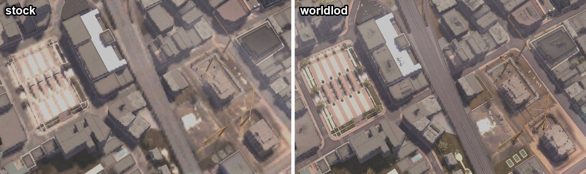
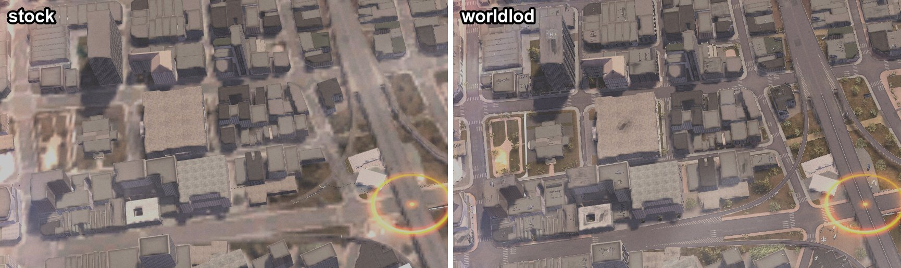
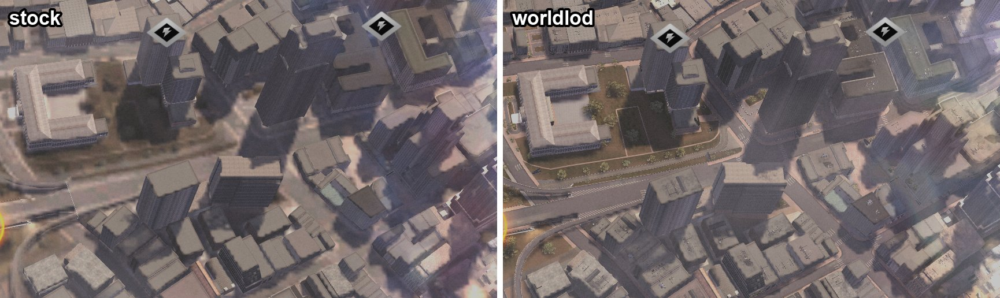

# DSF Enhanced

Improvements for Driver: San Francisco on PC (exe version 1.04), in two parts.
Each release has a ZIP for each:

- **DSF Enhanced** (`DSF-Enhanced-<version>.zip`): an ASI plugin that fixes ultrawide
  and cinematics, adds borderless mode and better filtering, raises detail and
  traffic, and lifts engine limits.
- **worldlod** (`worldlod-<version>.zip`): a high-detail map for the upper Shift levels,
  built from your own copy of the game. It brings DSF Enhanced along.

## DSF Enhanced

- Fixes the aspect ratio and widens gameplay FOV on ultrawide screens.
- Fits Bink cinematics inside the area the game draws them in, so movies keep their proportions.
- Adds borderless windowed mode and an option to turn off VSync.
- Forces anisotropic and trilinear texture filtering. It also has mip and LOD-bias settings.
- Draws traffic cars at full detail out to their draw distance, raises other gameplay LOD thresholds, and lets you extend how far away civilian traffic spawns.
- Sharpens the real-time sun shadows: their shadow maps are 3072x3072 instead of the High preset's 1536x1536 (`[Shadows] ShadowMapSize`, about 113 MB more video memory).
- Shrinks the distant brake and position lamp flares to small dots.
- Draws the passengers of the car you drive in the in-car camera. The game hides everyone in your car in that view, so after a Shift into a traffic car its passengers vanish from the cockpit view but show in the chase view (`[Quality] CockpitPassengers`).
- In the garage's vehicles screen, Up/Down switch to the previous or next maker while a maker's cars are open, so every maker's cars can be browsed without going back to the maker list.
- Plays Film Director replays back without the "old film" look (a grey-green tint, scratches, dust and hairs), so a replay looks like the game itself, with its own colour grade (`[Replay] DisableFilmEffect`). X during playback hides Film Director's menu; that is the game's own key.
- Skips the legal-screen wait and dismisses the prompt about Ubisoft's servers, which no longer exist.
- Lifts four engine limits that bigger world or car archives run into and crash on: 45,000 resources loaded at once (`[Limits] ResourceArenaExtraNodes`, 135,000 more by default, about 3 MB), 16,384 resource references waiting to be resolved (`[Limits] PendingResourceReferences`, 131,072 by default, 1.5 MB), 32,768 resources released at once, as when a replay starts in worldlod's map (`[Limits] ResourceReleaseListEntries`, 262,144 by default, 1 MB), and 15,000 submodels loaded at once (`[Limits] SubmodelTableExtraNodes`, 60,000 more by default, about 1.4 MB).
- Raises the engine's limits of 16,384 draws per frame and 4 MB of draw data per frame, which a heavy frame (worldlod's map, a wide screen, full-detail traffic) can pass and crash on (`[Limits] DrawQueueEntries`, 65,536 by default, about 50 MB with the draw data). If a frame still has more draws, the extra ones are dropped and logged rather than crashing the game.

### Install

Copy three files from `DSF-Enhanced-<version>.zip` into the game folder, next to `Driver.exe`:

- `winmm.dll` (Ultimate ASI Loader)
- `dsf_enhanced.asi`
- `dsf_enhanced.ini`

Settings live in `dsf_enhanced.ini`. The defaults turn on borderless mode, 16x anisotropic filtering, trilinear filtering, and higher gameplay detail. A few values you may want to change:

- `TrafficSpawnRadius=500` sets how far from you civilian cars spawn and despawn, in metres. `350` is the game's radius; `500` is the maximum, because larger radii overflow the game's traffic pools and crash.
- `VehicleFullDetail=0` restores the game's vehicle LOD steps; `VehicleLODThresholdScale` then scales them.
- `LODEngineThresholdScale` (terrain, pedestrians, drivers) and `MapDetailLODThresholdScale` at `1.0` restore the native LOD thresholds.
- Clear `DRLFlareScale` and `DRLFlareBrightness` in `[Lights]` to keep the game's lamp flares.
- `CockpitPassengers=0` hides your car's passengers in the in-car camera again, as the game does.
- `[Replay] DisableFilmEffect=0` keeps Film Director's old-film look on replays.
- `[Shadows] ShadowMapSize=4096` sharpens shadows a little more for 268 MB of video memory; `0` keeps the preset's size.
- `[General] Log=0` stops the plugin from writing `dsf_enhanced.log`.

To uninstall, delete the three files. If the game already has a `winmm.dll`, from another ASI loader for example, back it up before installing. Nothing here touches `Driver.exe` or `gameconfig.txt`.

## DLSS 5 (experimental)

DSF Enhanced can run NVIDIA DLSS 5 (DLSS 3D-Guided Neural Rendering) on the game's frame just before the HUD is drawn, so the HUD and menus stay as they are. DLSS 5 re-renders lighting and materials with NVIDIA's model. In this game, buildings and roads get firmer shading, and the film grain is smoothed out.

The model is 64-bit and the game is 32-bit, so a small 64-bit helper (`dlss5\dsf-dlss5-helper.exe`, in the release ZIP) runs it next to the game. NVIDIA's runtime DLL is not included and cannot be: you download it from NVIDIA's RTX Remix release (step 2). DLSS 5 is off by default, and nothing below changes the game unless you turn it on.

### Requirements

- An NVIDIA GeForce RTX 50-series GPU. Tested on an RTX 5070 Ti with driver 621.01. DLSS 5 needs a driver with DLSS 5 (DLSSNR) support.
- 64-bit Windows 10 or 11.
- DXVK 3.1.1 (step 3). Without DXVK it still works, but every frame is copied through the CPU, which costs about 15 ms a frame.
- `nvngx_dlssnr.dll` version 310.9.16.0 from NVIDIA's RTX Remix 1.6.1 (step 2). The helper accepts only that exact file.

### Turn it on

1. Install DSF Enhanced from the release ZIP as above, and also copy the ZIP's `dlss5` folder into the game folder. You should then have `dlss5\dsf-dlss5-helper.exe` next to `Driver.exe`.
2. Get `nvngx_dlssnr.dll`:
   - Download `rtx-remix-for-x64-games-release-remix-1.6.1.zip` (557 MB) from https://github.com/NVIDIAGameWorks/rtx-remix/releases/tag/remix-1.6.1.
   - Open it and copy `nvngx_dlssnr.dll`, which is at the top level of the zip, into the game's `dlss5` folder.
   - It should be 266,424,944 bytes with SHA-256 `2bc19bc09a7b89dd44f73e2ac0108fcc586e2154bdd0830f242f4f040e28789f`. To check, run this in PowerShell in the game folder: `Get-FileHash dlss5\nvngx_dlssnr.dll`.
3. Get DXVK:
   - Download `dxvk-3.1.1.tar.gz` from https://github.com/doitsujin/dxvk/releases/tag/v3.1.1. Its SHA-256 is `40565b4a724aadc4433fa4e010b4b23916d9b1f1baeee64e17186db94f54e608`.
   - Unpack it with `tar -xf dxvk-3.1.1.tar.gz` (Windows' own `tar` works).
   - Copy `dxvk-3.1.1\x32\d3d9.dll` into the game folder, next to `Driver.exe`. Its SHA-256 is `265888c31ca78dffa290c39cb7e50bfb02762590e41927906e46fb32f01497fa`.
   - Take the `x32` copy, not `x64`: the game is 32-bit. If the game folder already has a `d3d9.dll` (ReShade, for example), back it up first. Only one file can be `d3d9.dll`.
4. In `dsf_enhanced.ini`, under `[DLSS5]`, set:

   ```ini
   Export=1
   Helper=1
   ```

   The ini already points `HelperPath` and `HelperRuntime` at the `dlss5` folder.
5. Start the game. When a level loads, the picture changes after a second or two while the helper starts.

To see what happened, read `dsf-dlss5-helper.log` next to `Driver.exe`, and the `DLSS5 helper:` lines in `dsf_enhanced.log`. If the helper can't start or rejects the DLL, the log says why and the game runs on without DLSS 5.

### Settings

These keys are in `[DLSS5]` in `dsf_enhanced.ini`. Changes need a restart of the game.

- `Input` chooses what DLSS 5 sees:
  - `0` (the default) is the finished frame just before the HUD, with the game's colour grading, film grain and bloom already in it. DLSS 5's picture is drawn under the HUD.
  - `1` is the 3D scene before the game's post-processing, the way RTX Remix feeds DLSS 5. The scene is tone-mapped for DLSS 5, and DLSS 5's picture is tone-mapped back into the scene (with Remix's highlight recovery). The game then adds its own bloom, tone mapping, colour grading, film grain and HUD on top. Untested in game so far.
- `HdrExposure` (default `0.6`, `Input=1` only) sets how bright the image DLSS 5 gets is. The way back undoes it, so it only changes what DLSS 5 works on.
- `Style` (0-2, the model), `Intensity`, `ToneStrength` and `StructureStrength` (0-1) are RTX Remix's settings, with Remix's defaults (0, 1, 0.3, 0.7). On this game the defaults change the picture little: about 3-5 of 255 per colour channel on average. `Style=1`, `ToneStrength=1` and `StructureStrength=1` give the strongest change, about 5-13 of 255. Measured on still game frames.

### Turn it off

Set `Helper=0` and `Export=0` in `dsf_enhanced.ini`, or delete the two lines you changed; they default to off. To remove it entirely, also delete the `dlss5` folder and DXVK's `d3d9.dll`.

### Turn it off and on while playing

F10 turns DLSS 5 off and back on, so you can compare the two pictures (`[DLSS5] ToggleKey`). F11 does the same for DLAA (`[DLAA] ToggleKey`). The keys work only for what was on when the game started, and only while the game's window is in front.

Off, the next frame is the game's own. The helper keeps running, so turning DLSS 5 back on is instant; it starts from a fresh history, which can show in the first frame or two.

After each press, "DLSS 5 ON" or "DLSS 5 OFF" shows in the top left corner for 2 seconds, over the HUD:

- green: on;
- red: off;
- yellow: on, but not running this session (the helper or DLSS 5 stopped; `dsf_enhanced.log` says why).

`ToggleIndicator=0` hides it. Every press is also logged in `dsf_enhanced.log`, on a `Toggle:` line.

`ToggleIndicator=2` is for recording comparison footage: "DLSS 5" and "DLAA" stay in the top left corner on every frame where that feature is actually running, meaning its output is on screen that frame. A feature that is turned off, or has stopped (for example the helper failed), shows nothing.

`ToggleKey` takes a key name (F1-F24, A-Z, 0-9, Insert, Delete, Home, End, PageUp, PageDown, Pause, ScrollLock) or a Windows virtual-key code (`0x79` is F10). Empty or `0` means no key.

### Known limitations

- Experimental. Tested in single-player driving on one RTX 5070 Ti: the chase, cockpit and side views, the Shift zoom and the pause menu. The game ran at 1280x720, also in borderless mode on a 3440x1440 desktop. Other game resolutions, split screen and other GPUs are untested.
- Cars, the player's car and the car interior get their own motion vectors. Everything else uses camera motion: pedestrians, the driver's hands, wheel spin, loose panels and moving props. Those can smear when they move fast.
- The HUD and the pause menu are drawn over DLSS 5's image and stay as they are (tested). Bink cinematics and loading screens should be skipped the same way, but they weren't tested with DLSS 5 on.
- Frame cost on the RTX 5070 Ti with DXVK, at 1280x720 with nothing else loading the GPU: frames took 8.3-9.1 ms with DLSS 5 against 8.35-8.7 ms without. Without DXVK it adds about 15 ms a frame.
- Changes to `[DLSS5]` need a restart of the game.
- With `Input=1`, the game's low-resolution particle layer (drawn after the scene at a quarter of its width and height) is added after DLSS 5, so DLSS 5 does not process it.
- Only NVIDIA's signed `nvngx_dlssnr.dll` from RTX Remix 1.6.1 is accepted. A newer NVIDIA release would need a newer helper.

The helper contains NVIDIA's NGX loader from the NVIDIA DLSS SDK, under the NVIDIA RTX SDKs license (`dlss5\NVIDIA-RTX-SDKs-LICENSE.txt` in the ZIP). NVIDIA, RTX and DLSS are trademarks of NVIDIA Corporation. This project is not sponsored or endorsed by NVIDIA. How it works: [research/dlss5-renderer.md](research/dlss5-renderer.md) and [dlss5/README.md](dlss5/README.md).

## DLAA (experimental)

DLAA is NVIDIA's DLSS anti-aliasing at the game's own resolution (DLSS Super Resolution with no upscaling). The game's own anti-aliasing is a morphological filter on the finished frame. It can't fix what falls between pixels, so power lines, poles, fences, railings and foliage stay jagged and crawl when the camera moves. DLAA combines several frames, each drawn with the 3D scene moved by a different fraction of a pixel, and so it can.

It runs on any NVIDIA GeForce RTX GPU (20-series and later) and uses the same 64-bit helper as DLSS 5. It is separate from DLSS 5: you don't need DLSS 5, an RTX 50 GPU or the RTX Remix download for it. If you turn both on, DLAA runs first and DLSS 5 works on DLAA's anti-aliased picture. DLAA is off by default.

### Turn it on

1. Copy the release ZIP's `dlss5` folder into the game folder, as for DLSS 5 (step 1 there). You should then have `dlss5\dsf-dlss5-helper.exe` next to `Driver.exe`.
2. Get `nvngx_dlss.dll`. It isn't in the ZIP; you download it from NVIDIA's DLSS SDK, release v310.9.16:
   - https://raw.githubusercontent.com/NVIDIA/DLSS/9981c6350dc58c0ce21f024fd65e31e851c31689/lib/Windows_x86_64/rel/nvngx_dlss.dll (59 MB), or the same file from https://github.com/NVIDIA/DLSS/tree/v310.9.16/lib/Windows_x86_64/rel. Take the `rel` copy, not `dev`.
   - Put it in the game's `dlss5` folder, next to `dsf-dlss5-helper.exe` (and `nvngx_dlssnr.dll`, if you use DLSS 5 too).
   - It should be 58,956,912 bytes with SHA-256 `d00b5b0ab29c3ca101b70c3a5ecb3a01b7ef33766a3383a28a18623083e6123e`. To check, run this in PowerShell in the game folder: `Get-FileHash dlss5\nvngx_dlss.dll`. The helper refuses any other copy.
3. Optional but much faster: DXVK 3.1.1's `x32\d3d9.dll` next to `Driver.exe` (DLSS 5, step 3). Without it every frame is copied through the CPU, which costs about 15 ms.
4. In `dsf_enhanced.ini`, under `[DLAA]`, set:

   ```ini
   Enable=1
   ```

5. Start the game. When a level loads, edges get smooth after a second or two while the helper starts.

The `DLSS5 helper:` and `DLAA:` lines in `dsf_enhanced.log`, and `dsf-dlss5-helper.log`, say what happened. If the helper can't start or rejects the DLL, the game runs on with its own anti-aliasing.

### Settings

These keys are in `[DLAA]` in `dsf_enhanced.ini`. Changes need a restart of the game.

- `Enable=1` turns on DLAA, together with what it needs:
  - the scene jitter (a different sub-pixel offset each frame, which only the 3D scene gets: the HUD, shadows, minimap and mirrors don't move);
  - `DisableMLAA`: the game's MLAA is skipped on every frame DLAA anti-aliased;
  - `DisableSwapChainMSAA`: the swap chain drops the 4x MSAA the game's `AntiAliasing` setting asks for, which only costs video memory.

  Set `DisableMLAA=0` or `DisableSwapChainMSAA=0` to keep either.
- `Preset` is the DLAA model: `K` (the default, NVIDIA's default for DLAA) or `L` (sharper and steadier, with less ghosting, at about twice the cost).
- `MipBias` (default `-1`) sharpens textures in the 3D scene while it is jittered, as NVIDIA recommends. Use `0` if fine textures shimmer.
- `JitterPhases` (default 16) is the length of the jitter cycle.
- `ToggleKey` (default F11) turns DLAA off and back on while playing, with the same indicator as DLSS 5 ("Turn it off and on while playing" above). Off, the scene stops being jittered from the next frame and the game's MLAA comes back. Back on, DLAA starts a fresh history on one unjittered frame, and the jitter resumes after it.
- The helper keys in `[DLSS5]` apply to DLAA too: `HelperPath`, `HelperRuntime`, `HelperLog`, `HelperTransport`, `FrameTimeLog`, `ObjectMotion`, `CockpitDepth` and `ToggleIndicator`.
- `Jitter=1` and `JitterDebugPixels` are for testing, without `Enable`. Jitter alone only makes the picture shimmer.

To turn it off, set `Enable=0` (or delete the line). `nvngx_dlss.dll` can stay in the folder.

### Cost

Estimated, not yet measured in game. At 3440x1440 on an RTX 5070 Ti, preset K takes about 1.3-2 ms of GPU time and `L` about 2.5-3.5 ms. The frame is handed to the helper and back while the game waits, which adds about 1.5-2 ms with DXVK. All told, DLAA adds about 3-4 ms a frame with DXVK. Without DXVK the CPU copy adds about 15 ms. With DLSS 5 on too, each runs its own round trip. DLAA uses about 150-200 MB of video memory and saves the game's MLAA passes and the 4x MSAA swap chain (about 80 MB). `[DLSS5] FrameTimeLog=1` logs the measured costs.

### Known limitations

- Experimental and not yet tested in game: only the offline parts are tested (the jitter, the helper and the protocol).
- If DLAA stops working (no helper, a rejected DLL, a stalled or killed helper), the jitter stops and the game's MLAA comes back by the next frame. The frame on which DLAA fails is shown jittered without DLAA.
- Split screen keeps the game's MLAA: when the scene is drawn in more than one view, DLAA, the jitter and the MLAA skip stay off.
- Motion vectors are as for DLSS 5: cars have their own; pedestrians, wheel spin, sparks, smoke and scrolling textures use camera motion and can leave short trails.
- Only NVIDIA's signed `nvngx_dlss.dll` 310.9.16.0 is accepted.

How it works: [research/dlaa.md](research/dlaa.md).

## worldlod: a high-detail upper Shift

When you Shift up, the game draws one low-detail model of the whole city: flat ground under plain building shells. worldlod rebuilds it from the game's own detailed areas, with real roads, kerbs, paving, trees and bushes, building detail and painted road text. It reads your `san_francisco.dngc` and writes the new map into it, with a backup. No game data is shipped.

Stock (left) and worldlod (right) in the Shift view over downtown, same spot, crops of 3440x1440 screenshots:







### Install

1. Download `worldlod-<version>.zip` from the [latest release](https://github.com/xob0t/dsf-enhanced/releases/latest) and unzip it anywhere.
2. Close the game and double-click `install.cmd`.

The first time, it asks for the game folder and installs [uv](https://docs.astral.sh/uv/), which brings the Python worldlod runs on. It puts DSF Enhanced into the game if it isn't there, because the bigger map needs its `[Limits]` fixes. Then it builds the map (a minute or two) and installs it. `install.cmd --uninstall` puts the original map back and removes the DSF Enhanced files it added; the backup of the original map stays in the game's `worldlod-backup` folder. Options (`--no-trees`, `--no-buildings`, `--no-road-text`) and how it works are in [worldlod/README.md](worldlod/README.md).

## Build

You need Windows, PowerShell, and the Visual Studio 2022 C++ build tools with the x86 toolchain and a Windows SDK.

From the repository root:

```powershell
.\build.ps1
```

This writes the plugin files, this README, the license, `DSF-Enhanced.zip` and `worldlod.zip` to `dist/`. It also builds the DLSS 5 helper (`dlss5\build.ps1`) into `dist/dlss5/` and the ZIP. That build needs the x64 toolchain and downloads NVIDIA's DLSS SDK headers and static NGX loader from https://github.com/NVIDIA/DLSS, pinned by SHA-256. `.\build.ps1 -SkipDlss5` leaves the helper out. To install the plugin into a local copy of the game:

```powershell
.\install.ps1 -GamePath "D:\Games\Driver San Francisco"
```

`install.ps1` runs the build first if `dist/` is missing any files. worldlod's own development setup (uv, tests, ruff) is in [worldlod/README.md](worldlod/README.md).

## Releases

Releases are built by GitHub Actions ([.github/workflows/release.yml](.github/workflows/release.yml)). To release, push a version tag:

```powershell
git tag v1.2.0
git push origin v1.2.0
```

The workflow then runs worldlod's tests and lint and `build.ps1` on that tag, and publishes the GitHub release with `DSF-Enhanced-v1.2.0.zip` and `worldlod-v1.2.0.zip` and generated release notes. Started by hand from the Actions tab, it only builds and keeps both ZIPs as the run's artifacts.

## Repository layout

- `src/` has the plugin source and the default `dsf_enhanced.ini`.
- `tests/` has the cinematic fit test and the DLAA jitter's vertex shader patch test. `build.ps1` runs both and stops if one fails.
- `dlss5/` has the experimental DLSS 5 helper: a 64-bit process that runs NVIDIA's DLSS 5 pass for the 32-bit game, and its offscreen tests. It has its own build script and README. The release ZIP carries the helper in its `dlss5` folder.
- `research/` has design notes.
- `third_party/winmm.dll` is the bundled [Ultimate ASI Loader](https://github.com/ThirteenAG/Ultimate-ASI-Loader), MIT-licensed.
- `worldlod/` is the map pipeline (Python, `src/dsfworld/`), its release launcher (`release/`), the vendored meshoptimizer simplifier (`native/`, MIT) and its research notes.

## License

MIT. See `LICENSE`.
