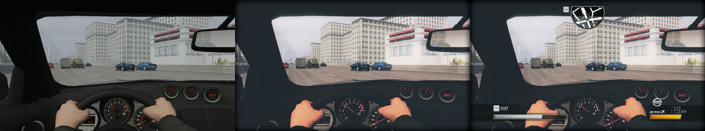
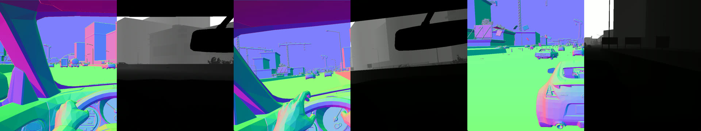
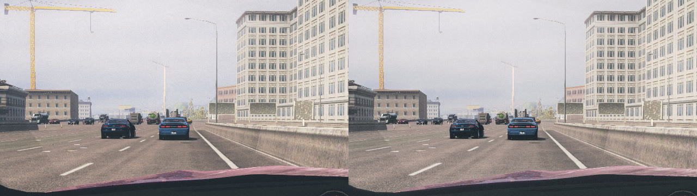
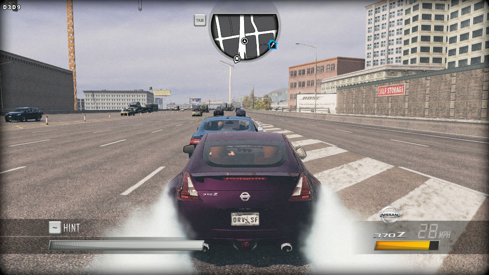
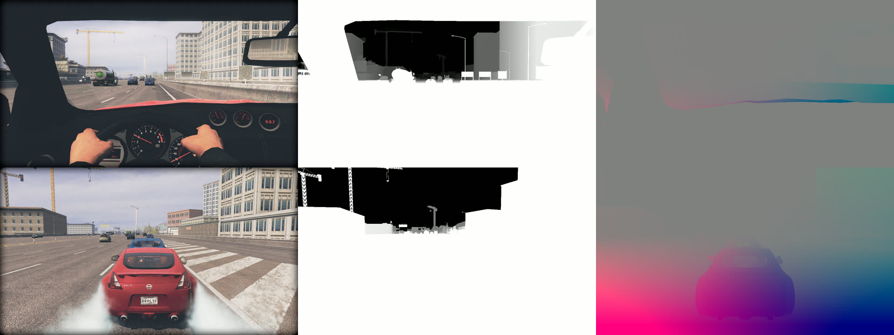

# DLSS 5 for Driver SF: the renderer, the bring-up routes and the game side

Status 2026-10-29: the renderer questions are answered from D3D9 captures taken inside the game,
and DSF Enhanced runs DLSS 5 in game through the open-source helper of PR #14 (`dlss5/`). Under
DXVK the frames go GPU to GPU. On the RTX 5070 Ti with the test VMs off, a frame with DLSS 5 takes
about as long as one without it (8.3-8.5 ms). Elsewhere (native D3D9, dgVoodoo2) the frames go
through the CPU, which adds 2 to 6 ms a frame. Motion vectors are camera-only, so the cars are
still open.

Evidence levels: *runtime* (seen in a capture or a dump in the run named), *static*
(disassembly), *inferred* (follows from the runtime evidence but was not observed directly).

Run folders are under `%LOCALAPPDATA%\Temp\dsfforza-wsb\runs\` and come from driversf-forza's
`tools\wsb\run-series.ps1`: `vm1-*`/`vm2-*` in the headless test VMs, `host-*` on the host
(RTX 5070 Ti, driver 621.01), always with the vanilla archive (`out\vanilla\Install\dngvehicles.sp`),
probe ID 227 (Nissan 370Z: chase view, cockpit view driven at 20 and 40 mph) and DriverNGHook 0.7.2.

## Answers

| Question | Answer | Level |
| --- | --- | --- |
| Deferred or forward? | Forward. One HDR scene pass (1280x720 `A16B16G16R16F` + `D24S8`, 2,500 to 2,700 draws), one colour target, no G-buffer. Every full-resolution render target the game creates is accounted for in the pass list below. | runtime |
| Depth buffer | `D#4`, a `D24S8` depth-stencil surface at back-buffer size, made by `CreateDepthStencilSurface` (caller `0xBB23AE`). Standard Z: 0 near, 1 far, near plane about 0.15 m, far about 19 km in the cockpit (solved from the matrices). Complete when the scene pass ends. Nothing after the scene reads it or clears it until the next frame's scene clear. The HUD pass uses a second surface of the same size (`D#2`). | runtime |
| Where the 3D scene ends and the HUD starts | Scene end: the `SetRenderTarget` that leaves the scene target (render-queue target set 35), at `0xBB0FE4` in the pass setup `FUN_00BB0ED0`. HUD start: draw 2 of the pass on target set 0 (`T#1`, 1280x720 `A8R8G8B8`). Draw 1 of that pass is a full-screen quad (pixel shader hash `F5ACBC8D`) that composites the post chain into `T#1`. Draws 2 onwards are the HUD. `T#1` is then `StretchRect`'d to the back buffer (`0xBB293F`). | runtime |
| View and projection matrices | No per-frame matrix is uploaded. Each scene draw sets `c0-c3` = World·View·Proj rows and `c4-c6` = the object's 3x4 world rows, so VP = WVP · World⁻¹. DSF Enhanced solves it per frame and keeps the previous frame's. The game also keeps camera matrices on the heap in D3DX (transposed) layout. No static pointer chain to them is known yet. | runtime (constants, VP solve), runtime but unresolved (heap copies) |
| Velocity data | None. No velocity or motion target is created, and no vertex constant carries last frame's matrices. Motion vectors have to be made from depth and the two VP matrices (camera motion), plus per-object data later. | runtime |
| Post-process order | Scene (HDR) → downsample and bright pass (320x180) → eye adaptation (luminance mip chain to 1x1 `R32F`) → bloom (320x176 down to 40x22 and back) → tone map into LDR `T#30` (reads the scene, bloom and adaptation) → two full-resolution LDR passes (`T#28` `R5G6B5`, then `T#29`) → composite of `T#30` and `T#29` into `T#1` → HUD → back buffer. Vignette and film grain are already in the image at the pre-HUD point. What `T#28`/`T#29` do (anti-aliasing, a blur) is not identified. | runtime (order), inferred (what the last two passes do) |
| Projection jitter through the existing projection patch | Not through the FOV patch: `0xDD9A80` is a degrees-to-radians scalar that feeds the projection's scale, so it cannot add an offset. Through the vertex constants it works for world draws: adding `j·row3` to rows 0 and 1 of `c0-c3` at draw time shifted the world by the asked 48 px with the HUD in place (`host-20261029-103256`). Skinned and cockpit shaders use another constant layout and did not move. Since PR #14 found that the DLSS 5 runtime never reads jitter, jitter was taken out of the scope and the code removed. | runtime |

## The frame

One gameplay frame in the 370Z, DXVK on the host (`host-20261029-103023`, frame 3871). `set` is
the render-queue target set id the executor stores at `0x1D4AD10` before each pass (see "Hooks").

| # | Target | Depth | Set | Draws | What |
| --- | --- | --- | --- | --- | --- |
| 0 | `T#65` 3072² `A8R8G8B8` | `D#68` | 60 | 524 | sun shadow map (`[Shadows] ShadowMapSize=3072`) |
| 1-2 | `S#37` 432x304 | `D#38` | 63 | 13 | minimap, copied to `T#36` |
| 4-5 | `T#48` 128x832 fp16, then 64x416 | `D#46` | 41, 42 | 9, 1 | one distant-scene strip a frame (rear-view mirror research) |
| 6 | `T#3` 1280x720 fp16 | `D#4` | 35 | 2,731 | the scene, 1.07 M triangles |
| 7-28 | 320x180 down to 1x1 | none | 2-23 | 1 each | bright pass, adaptation, bloom |
| 29 | `T#30` 1280x720 `A8R8G8B8` | none | 26 | 1 | tone map |
| 30 | `T#28` 1280x720 `R5G6B5` | none | 24 | 1 | ? |
| 31 | `T#29` 1280x720 `A8R8G8B8` | none | 25 | 1 | ? |
| 32 | `T#1` 1280x720 `A8R8G8B8` | `D#2` | 0 | 38 | draw 1 composite, then the HUD |
| 34 | back buffer | | | | `StretchRect` from `T#1` |

The same structure shows on native D3D9 in the VM (`vm1-20261029-101941`: scene `T#3`/`D#4`, 504
draws in the cockpit at the VM's lower detail) and in the Shift overview (`host-20261029-101706`).

Left to right: the scene target when the scene pass ends, `T#1` right after draw 1 of set 0 (the
pre-HUD frame), and `T#1` after draw 32 with the HUD. Dumped from the same frame
(`host-20261029-103023`, `TraceDump=1`).

## View-projection

Logged per draw in `host-20261029-102224`. World tile draws upload, for example,
`c0 = (-1.732, 0, 0, -532.2)` with `c4 = (1, 0, 0, -512)` and `c6 = (0, 0, 1, 2048)`: the world rows
are a pure translation and `c0-c3` already contain it. Skinned and cockpit draws (the first 50 or
so of the scene) put rotations in `c0-c6` instead.

DSF Enhanced solves VP = WVP · World⁻¹ for each scene draw, rejects results that are not a
perspective matrix (row 3's xyz must be a unit vector and row 2 parallel to it), and takes the
value most draws agree on (`dlss5_feed.inl`, `D5AddViewProjCandidate`). Results:

- Shift overview: 3,825 of 4,000 draws agree (`host-20261029-103023`, frame 2797).
- Cockpit and chase gameplay: 682 to 757 draws agree, and no other candidate reaches 3 (frames
  3871, 4791). The rest are draws with other layouts.
- Cockpit matrix, frame 3871: x scale 1.333, y scale 2.370 (16:9, about 74° horizontal FOV),
  row 2 = 1.000008 · row 3 − 0.15 (near 0.15 m).
- Consecutive frames differ slightly, as a moving camera should (3871 against 3872).

Two earlier iterations got this wrong, and both mistakes are worth knowing for anyone redoing it.
A matrix tolerance relative to the row's largest element (the translation, about 1,400) merged
junk with the real matrix (`host-20261029-102730`). And skinned draws that repeat one rotation in
`c0-c3` and `c4-c6` all solve to the same permutation matrix, which won a vote before the
perspective check existed.

**Game memory.** An approximate scan for the solved VP's first column found the projection in
D3DX layout on the heap (`0x027BBD6C`: 1.332, 2.366, −1.00363 / −1, −109.0 in the overview, near
plane about 108 m at that altitude), followed by a VP for a nearby frame
(`host-20261029-101706`). Those are heap addresses of one session. A static path to the camera
(camera manager at engine+0x34C, render contexts at engine+0x334 per the split-screen notes) is
still to find in Ghidra. The constant solve does not need it.

## Bring-up routes

Three ways to get the game's D3D9 frame to a 64-bit DLSS consumer were tried. All three run with
DSF Enhanced's import patch, its device hooks and DriverNGHook loaded together.

| Route | Where tested | DSF Enhanced hooks | ReShade 6.8.0 sees scene depth (DisplayDepth) | Notes |
| --- | --- | --- | --- | --- |
| DXVK 3.1.1 (d3d9 → Vulkan) + ReShade as a Vulkan layer | host | detours on DXVK's `d3d9.dll` | yes (`host-20261029-100756`) | The VM cannot run it: VMware SVGA 3D 9.17.11.4 has a Vulkan loader (1.3.300) but no Vulkan ICD. The layer is enabled per process with `VK_ADD_LAYER_PATH` and `VK_INSTANCE_LAYERS=VK_LAYER_reshade`, so nothing is installed or written to the registry. |
| Native D3D9 + ReShade as `d3d9.dll` | VM | detours on ReShade's proxy | yes (`vm2-20261029-102342`) | ReShade logs "Failed to create query heap" in the VM. The effect still runs. |
| dgVoodoo2 2.87.6 (d3d9 → D3D11) + ReShade as `d3d11.dll` | VM, host | detours on dgVoodoo's `D3D9.dll` | yes on the host (`host-20261029-104855`) | In the VM the game renders (the scene pass is found) but every harness screenshot is black (`vm1-20261029-102458`). dgVoodoo creates two swap chains, so ReShade writes `ReShade2.ini` beside its own. dgVoodoo is freeware, not open source. |

**DriverNGHook.** It patches `Direct3DCreate9` ("D3D9 Hooking Patch", "Direct3DCreate9 captured")
and wraps the device (`WrappedD3DDevice9`) for its ImGui overlay. DSF Enhanced patches the same
import from its own thread. In every run DSF Enhanced's `CreateDevice` received the device of
whatever `d3d9.dll` the game loaded (Microsoft's, ReShade's, DXVK's or dgVoodoo's) and hooked that,
and DriverNGHook's wrapper sat outside it ("New Wrap D3D Device created" in each `Driver.log`). The
probe's Lua, which goes through DriverNGHook, ran in all of them. The game's calls do not all go
through the device vtable, so DSF Enhanced detours the methods at their first instructions.
That also catches calls made through cached method pointers.

**A crash on the first DXVK run** (`host-20261029-100438`, DriverNGHook fatal error while
loading) came from my branch being cut from an old `main` that lacked the world-load crash fix
(`9b9c40e`). The branch now sits on `origin/main`, and no later run crashed.

**DLSS5-ReShade-AIO** (kibblerz, Apache-2.0), input side only, read from source at `main`
2026-09-11. Its native D3D9 route is ReShade as `d3d9.dll` plus its `.addon32`. The add-on takes
ReShade's finished frame (a `DLSS5_Feed_D3D9.fx` identity pass) through ReShade's internal D3D10.1
runtime and sends it to its 64-bit carrier. It sends no depth and no motion. In
`x86-host/src/aio-wrapper32.cpp` (lines 374-377) the guides are "deliberately neutral until a real
D3D9 motion/depth provider is available", and it binds a zero depth texture. In Driver SF that
frame is taken at Present, after the HUD, because the HUD is drawn into `T#1` before the copy to
the back buffer. The ReShade `d3d9.dll` proxy it relies on coexists with DSF Enhanced and
DriverNGHook (row 2 above). I did not run its add-on.

## Game side (DSF Enhanced)

All of it is behind `[DLSS5]` in `dsf_enhanced.ini` and off by default. With every key off, the
plugin installs no new hooks and imports no new DLLs. Code: `src/dlss5_feed.inl` (hooks,
pre-HUD point, VP, trace), `src/dlss5_bridge.inl` (helper client), `src/dlss5_shared.h` (export
layout).

**Hooks.** On device creation, 20 device methods and `IDirect3DSwapChain9::Present` are detoured
at their prologue (`D5Hook`, a small x86 length decoder; anything that does not decode falls back
to a vtable write). Logged per route in each run's `dsf_enhanced.log` ("DLSS5: detoured ...").

**Pre-HUD point.** The scene target is the busiest target of back-buffer size that draws with a
depth surface. The pre-HUD point is just before draw 2 of the pass whose render-queue target set
(read from `0x1D4AD10` when the target changes) is `PreHudTargetSet` (0). A counter in the shared
memory (`pre_hud_missed`) counts frames where the scene ended but the point was not found.

**Export** (`Export=1`). At the scene end and at the pre-HUD point DSF Enhanced publishes a
`Dsfe5FrameInfo`: frame index, this and last frame's VP (rows as uploaded, D3D9 clip space),
sizes. It goes to the shared memory `Local\DSFEnhanced.DLSS5.<pid>` (a seqlock) and to callbacks
registered through the exported `DSFE_RegisterPreHudCallback`. The callbacks run on the render
thread with the game's device, the current colour target and the scene depth. A ReShade add-on can
render its effects at the pre-HUD point this way.

**DLSS 5 through the helper** (`Helper=1`, PR #14's protocol version 1). This first version
copied every frame through the CPU. The next section covers the GPU path under DXVK, the
protocol rework and the frame times.

1. The back-buffer-sized `D24S8` depth surfaces are created as the top level of an `INTZ`
   texture, so the scene depth can be sampled (logged as "created as INTZ").
2. At the pre-HUD point two D3D9 quads write depth (`R32F`, z/w) and motion (`G16R16F`, previous
   minus current position in pixels, +y down). Motion reprojects each pixel through the inverse
   of this frame's VP and last frame's VP. Pixels nearer than `CockpitDepth` (1.5 m) get zero
   motion, because the car interior moves with the camera.
3. Colour (`T#1` after the composite, `B8G8R8A8`), depth and motion are read back and uploaded
   into D3D11 textures DSF Enhanced shares with the helper (`CLIENT_CREATES`). Then
   `fence_in = n`, FRAME, FRAME_ACK, wait `fence_out = n`.
4. The output (`R8G8B8A8`) is read back and drawn over `T#1`. The game then draws the HUD on top.

The helper is started with `--game-pid`, an inherited process handle, `--runtime` and `--log`, as
in PR #14's client test. Run `host-20261029-104522` (DXVK, helper `bb1bfdc8…`, `nvngx_dlssnr.dll`
310.9.16.0 `2bc19bc0…`):

- HELLO_ACK OK on the RTX 5070 Ti, CONFIGURE 1280x720 OK, 1,200+ frames evaluated, all acks OK.
- DLSS 5 evaluate 1.6 ms GPU on average.
- The CPU round trip (two readbacks and an upload each way, synchronous) takes 13 to 14 ms a frame.
- The helper exits when the game does.

On this frame the output differs from the input by 2.1 to 2.6 of 255 on average per channel, up
to 41. Shading on the buildings and the road gets firmer, and the film grain is smoothed out.

From `host-20261029-105250`. In the cockpit (top) the interior has zero motion and the road and
buildings stream outwards from the vanishing point, as they should while driving forward. In the
chase view (bottom) the player's car gets the road's motion. It moves with the camera, so its
true motion is close to zero. That is the main gap in these motion vectors (below).

## GPU-to-GPU under DXVK, robustness, frame times

**Transport.** `HelperTransport=0` (the default) picks Vulkan under DXVK and the CPU copy
everywhere else; 1 and 2 force one. The Vulkan transport (`dlss5_bridge.inl`, `D5VkFrame`):

1. DXVK's D3D9 interop (`ID3D9VkInteropDevice`, `ID3D9VkInteropTexture`; declarations in
   `src/vk_min.h`) gives the VkImage of the HUD target `T#1`, of our depth and motion textures and
   of the composite texture, plus DXVK's VkDevice and queue. DXVK 3.1.1 enables
   `VK_KHR_external_memory_win32` and `VK_KHR_external_semaphore_win32` when the GPU has them.
2. The helper creates the shared textures and fences on D3D12 (the protocol's helper-creates
   direction, `DSF_DLSS5_API_VULKAN`). DSF Enhanced imports them as Vulkan external memory
   (`VK_EXTERNAL_MEMORY_HANDLE_TYPE_D3D12_RESOURCE_BIT`, dedicated allocation) and timeline
   semaphores (`..._D3D12_FENCE_BIT`).
3. Per frame, holding the D3D9 device lock: transition the four images, flush DXVK, lock its
   queue, submit our copies (colour, depth, motion into the shared textures) with
   `fence_in = n`, unlock.
4. FRAME n, then FRAME_ACK n. The helper sends the ACK after its GPU work, so `fence_out >= n`.
   Only after an OK ACK: lock the queue, submit the output copy that waits on `fence_out = n`,
   unlock.
5. Transition back and draw the composite texture over `T#1`. The output is `R8G8B8A8`; the
   composite shader swaps red and blue.

Checked on the host: the output matches the CPU path. The per-channel means of input and output
are equal to 0.1 of 255, with the same 2-2.3 of 255 DLSS 5 difference (`host-20261029-112007`).

**Protocol rework of #14** (head 8eaadef). The pipe is opened for overlapped I/O and every
message has a timeout (HELLO and CONFIGURE 20 s, FRAME and FRAME_ACK 3 s). HELLO and CONFIGURE
run on a worker thread, so the render thread never waits for the helper to start or to create
the feature. Until CONFIGURE is done, frames go out without DLSS 5. Frame numbers restart at 1
after each CONFIGURE. A FRAME_ACK with an error status shows the game's own frame and triggers a
new CONFIGURE, three times at most. A timeout, a closed pipe or an ERROR message turns DLSS 5 off
for the session. No GPU wait on `fence_out` is queued before an OK ACK.

**Fault tests** (host, `out\dlss5\scripts\fault-run.ps1` in the harness worktree; it only touches
the helper whose parent is the run's own `Driver.exe`):

| Test | Run | What happened |
| --- | --- | --- |
| Helper suspended 40 s into DLSS 5 (pssuspend) | `host-20261029-162224`, `-171932` | FRAME timed out after 3 s and DLSS 5 went off for the session. One 3 s frame, then 8.3-8.5 ms frames without DLSS 5 to the end of the run |
| Helper killed 40 s into DLSS 5 | `host-20261029-171753` | "FRAME got no answer (pipe closed)". One 85 ms frame, then normal frames to the end |

**A crash, found and fixed.** The first Vulkan builds crashed in about 1 run of 4: 6 crashes in
about 20 runs (`host-20261029-114455`, `-162404`, `-163039`, `-163245`, `-164447`, `-164643`).
Each ended in DriverNGHook's "We got an fatal error" dialog, 25-50 s into DLSS 5. A vectored
exception handler registered ahead of DriverNGHook's (`D5LogException`, on while `Helper=1`)
caught it: an access violation reading 0x4 at DXVK's `d3d9.dll`+0x24696, on the game's main
thread, while the render thread was in the bridge's `FlushRenderingCommands`. The handler's
minidump (`dsf_dlss5_crash_<pid>.dmp`, `host-20261029-165651`) shows the main thread at
`Driver.exe` 0xBB9021, a vertex or index buffer `Lock` (vtable slot 11). The game creates its
device with `D3DCREATE_MULTITHREADED` (behaviour flags 0x44) and locks dynamic buffers from the
main thread while the render thread draws. DXVK's interop calls don't take the device lock that
D3D9 calls take, so the flush raced the `Lock`. The bridge now holds `LockDevice` around its
interop calls and releases it while the helper works. Ten runs after the fix had no crash
(`host-20261029-170028` to `-171522`).

**Frame times.** `FrameTimeLog=1` logs present-to-present intervals in 600-frame windows. All
runs use the same probe (cockpit drive at 20 and 40 mph, then the chase view), 1280x720 and
`RemoveVSync=1`, on the RTX 5070 Ti:

| Configuration | Test VMs | Runs | Mean frame | Bridge on the render thread | Evaluate |
| --- | --- | --- | --- | --- | --- |
| No DLSS 5 (`Helper=0`) | idle or off | `host-20261029-162xxx`, `-1724xx` | 8.35-8.7 ms | | |
| CPU copy | idle or off | `host-20261029-172110` | 10.6-14.0 ms | 6.6-8.4 ms | 1.6 ms |
| Vulkan | idle or off | `host-20261029-171753`, `-171932`, `-170028` to `-171522` | 8.3-9.1 ms | 2.6-3.7 ms | 1.6 ms |
| No DLSS 5 | both running series | `host-20261029-112503`, `-113629` | 8.5-9.1 ms | | |
| CPU copy | both running series | `host-20261029-112851` | 21.7-22.3 ms | 14.5-15.9 ms | 1.6 ms |
| Vulkan | both running series | `host-20261029-113240`, `-113940` | 10.9-13.2 ms | 5.2-5.9 ms | 1.6 ms |

The test VMs render on the same GPU and their load moves every number, so each comparison was run
back to back under one condition. The Vulkan frame barely grows because the bridge's
render-thread time overlaps with GPU work. Most of those 3 ms is the render thread waiting for
the helper's evaluate, while the GPU would be finishing the frame anyway. The bridge waits for
each frame's ACK, since the protocol acks after the helper's GPU work. A frame-lagged mode could
hide that wait at the cost of a frame of latency.

## Per-object motion (measured, not built)

The motion vectors are camera-only. To see how much that misses, traced frame pairs (`Trace=1`,
`D5AnalyseObjectMotion`) key each scene draw by its vertex shader and draw parameters. They keep
the draws whose `c0-c3`/`c4-c6` give the frame's VP and compare their world rows with the
previous frame (`host-20261029-172933`):

- Those draws are the static world and props. In eight frame pairs there were 739 to 7,404 of
  them. All were unchanged except a handful: one object at 187 km/h, off by 9.5 px with
  camera-only motion, and 15 small objects drifting under 1 km/h.
- The cars are not among them. A second run dumped `c0-c19` of the scene draws that don't give
  a VP (`host-20261029-173201`, 400 draws, 24 vertex shaders). The busiest skinned shaders
  (`09F253A9`, `0F92BA98`, `2E410648`, `1141C8D3`) start with a bone palette at `c0` (rotation
  rows, no translation), so the car's own transform lives in higher registers that were not
  dumped. Some terrain shaders (`8DCC1218`, 106 draws) upload a plain VP at `c16-c19`, which
  could serve as a second VP source.

Per-object motion for cars needs three things, in this order:

1. The skinned car shaders' constant layout: where the object-to-world matrix or the WVP sits.
   A wider dump or the shader bytecode would show it.
2. An object key that survives a frame: the vertex buffer and draw parameters, or the engine's
   vehicle pointer.
3. Per-pixel object identity in the motion pass. The plan is to re-issue the moving objects'
   draws at the pre-HUD point into an ID target, depth-tested against the scene depth. That
   means hooking `SetStreamSource`, `SetIndices` and `SetVertexDeclaration` and holding
   references to the buffers until the replay. The motion pass then uses each object's
   `VP_prev·W_prev·W_cur⁻¹·VP_cur⁻¹`.

None of it is started.

## Tools

- `[DLSS5] Trace=1` logs a few frame pairs: every pass (target, depth, target set, draws,
  render-target textures read, pixel shader hashes), per-draw lines outside the scene and for the
  first 150 scene draws, the VP solve and the per-object motion measurement. `TraceScan=1` adds
  the memory scan for the solved VP, which stalls that frame for seconds. `TraceDump=1` writes BMPs
  (scene end, pre-HUD, the HUD pass after draws 1 to 48, and the helper's depth and motion).
- `FrameTimeLog=1` logs frame times every 600 frames.
- With `Helper=1` a vectored exception handler logs exceptions and writes the first non-routine
  one to `dsf_dlss5_crash_<pid>.dmp` beside `Driver.exe`. The harness copies it into the run
  folder.
- `tests/vk_min_check.cpp` checks `src/vk_min.h` against the Khronos Vulkan headers when
  `build.ps1` runs with `VULKAN_HEADERS_INCLUDE` set. It passes against Vulkan-Headers
  `vulkan-sdk-1.4.363.0`.
- driversf-forza: a separate PR makes `run-test.ps1` keep every `*.log` beside `Driver.exe`
  (`ReShade.log`, DXVK's `Driver_d3d9.log`).

## Third-party files used (not committed)

| What | Version | Source | SHA-256 |
| --- | --- | --- | --- |
| DXVK | 3.1.1 | https://github.com/doitsujin/dxvk/releases/download/v3.1.1/dxvk-3.1.1.tar.gz | `40565b4a724aadc4433fa4e010b4b23916d9b1f1baeee64e17186db94f54e608` (x32 `d3d9.dll` `265888c3…`) |
| ReShade with add-on support | 6.8.0 | https://reshade.me/downloads/ReShade_Setup_6.8.0_Addon.exe | `afe4c8f13048306307983b8b3d41d5bf00a86820440b0e57dea10950e1176445` (`ReShade32.dll` `da430e0a…`) |
| reshade-shaders (slim) | `fd002217` | https://github.com/crosire/reshade-shaders/tree/slim | zip `a3b110ba5118f3b944d74f0b0746c21280071d389ed98d615bf3c4b3a1778586` |
| dgVoodoo2 | 2.87.6 | https://github.com/dege-diosg/dgVoodoo2/releases/download/2.87.6/dgVoodoo2_87_6.zip | `9afa493396feec7108f42a2d97661eef96bbaac5addf0dfb5cfbc3001cd76a0a` (`MS/x86/D3D9.dll` `060cb161…`) |
| `nvngx_dlssnr.dll` | 310.9.16.0 | RTX Remix 1.6.1 (see `dlss5/README.md`) | `2bc19bc09a7b89dd44f73e2ac0108fcc586e2154bdd0830f242f4f040e28789f` |

## Open

- **Per-object motion.** Cars, traffic and the player's car in the chase view get camera motion
  only. What it takes is in "Per-object motion" above.
- **dgVoodoo2 without the CPU copy.** dgVoodoo gives the game side no access to its device, so
  DSF Enhanced would need its own D3D11 path into dgVoodoo's swap chain. Not tried, because DXVK
  is the open route and already has the GPU path.
- **The per-frame wait.** The render thread waits for each FRAME_ACK (2.6-3.7 ms with idle VMs).
  A frame-lagged mode would hide it at the cost of a frame of latency.
- **Mask.** No `ControlMask` yet. The Shift-mode edge glow and the 3D HUD meshes are drawn in the
  HUD pass, so they stay out of DLSS already. Fog, particles and tyre smoke are in the scene and
  get the full effect.
- **The two LDR passes before the composite** (`T#28` `R5G6B5` and `T#29`): which effect they are,
  and whether DLSS 5 should see the frame before them.
- **Static camera address.** Turning the heap copies of the camera matrices into a pointer path
  in Ghidra would make the VP solve a cross-check instead of the only source.
- **Split screen and cutscenes.** Only single-player gameplay and the Shift overview were
  traced. Bink cinematics, menus and loading screens skip the scene pass; the bridge then sends
  nothing.
